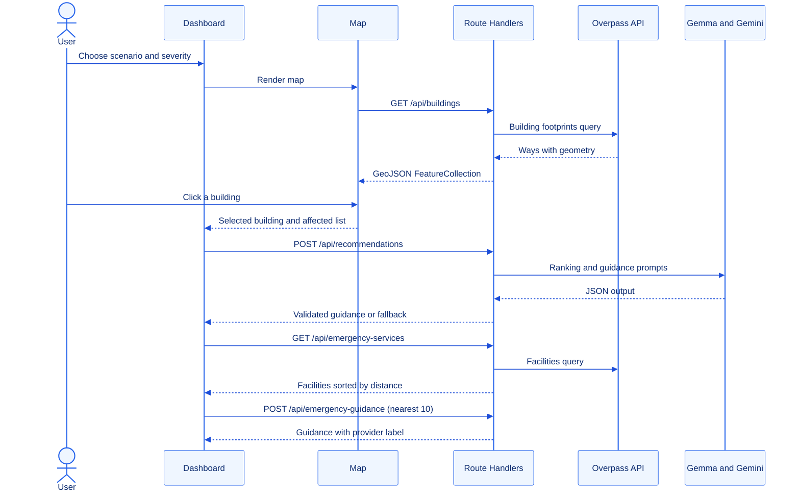
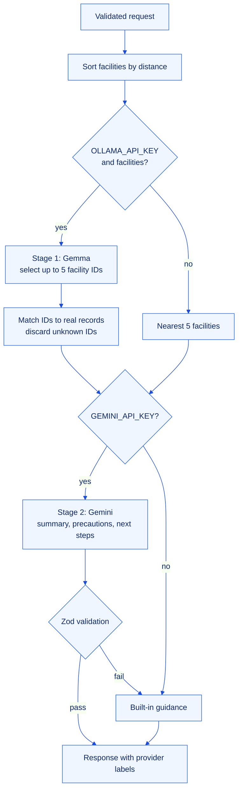

<div align="center">


<h1>Project Brain</h1>

<p><b>The single source of truth for how Chandigarh SafeSim is designed, how it behaves and why.</b></p>

<p>
  
</p>

<p>
  <a href="../README.md"><b>README</b></a>
  &nbsp;&nbsp;|&nbsp;&nbsp;
  <a href="CONTRIBUTING.md"><b>Contributing</b></a>
  &nbsp;&nbsp;|&nbsp;&nbsp;
  <a href="../LICENSE"><b>License</b></a>
</p>

</div>


## Contents

1. [Purpose of This Document](#1-purpose-of-this-document)
2. [Product Model](#2-product-model)
3. [System Architecture](#3-system-architecture)
4. [Module Reference](#4-module-reference)
5. [API Contracts](#5-api-contracts)
6. [Core Algorithms](#6-core-algorithms)
7. [AI Pipeline](#7-ai-pipeline)
8. [Reliability and Performance](#8-reliability-and-performance)
9. [Safety Principles](#9-safety-principles)
10. [Design Decisions](#10-design-decisions)
11. [Known Limitations](#11-known-limitations)
12. [Glossary](#12-glossary)


## 1. Purpose of This Document

This document captures the knowledge a new contributor, reviewer or judge needs to understand the system without reading every line of code. It is intended to be kept current: any change to an API contract, algorithm or architectural boundary must be reflected here in the same pull request.

| Audience | Start with |
| :-- | :-- |
| Reviewers and judges | [Product Model](#2-product-model), [System Architecture](#3-system-architecture), [Safety Principles](#9-safety-principles) |
| New contributors | [Module Reference](#4-module-reference), [API Contracts](#5-api-contracts), [Known Limitations](#11-known-limitations) |
| AI and data work | [Core Algorithms](#6-core-algorithms), [AI Pipeline](#7-ai-pipeline) |

## 2. Product Model

### 2.1 Core entities

| Entity | Description | Source |
| :-- | :-- | :-- |
| **Scenario** | The incident type being simulated: `building-collapse` or `major-fire`. `urban-flooding` and `earthquake` are shown as coming soon. | `app/page.tsx` |
| **Severity** | `Low`, `Medium` or `High`, mapped to an illustrative impact radius. | `app/page.tsx` |
| **Building** | An OpenStreetMap `way` tagged `building`, normalized into a GeoJSON polygon with a human-readable name. | `/api/buildings` |
| **Impact zone** | A circle around the selected building with the radius chosen by severity. | `BuildingCollapseMap.tsx` |
| **Affected building** | Any footprint whose geometry intersects the impact zone. | `BuildingCollapseMap.tsx` |
| **Facility** | A hospital, clinic, doctor, police station, fire station or pharmacy from OpenStreetMap. | `/api/emergency-services` |
| **Guidance** | A summary, precautions and next steps produced by AI or by the built-in fallback. | `/api/recommendations`, `/api/emergency-guidance` |

### 2.2 Severity to radius mapping

| Severity | Radius | Intended reading |
| :-- | :-- | :-- |
| Low | 75 m | Immediate surroundings of the selected building |
| Medium | 150 m | Neighbouring block |
| High | 250 m | Wider sector-level area |

The radii are illustrative. They are not derived from a structural or fire-spread model and must never be presented as such.

### 2.3 User journey



## 3. System Architecture

### 3.1 Layers

| Layer | Responsibility | Location |
| :-- | :-- | :-- |
| Presentation | Dashboard layout, scenario controls, result panels | `app/page.tsx`, `app/layout.tsx` |
| Map engine | Rendering, selection, impact-zone geometry, affected-building detection | `components/BuildingCollapseMap.tsx` |
| Facility panel | Facility discovery, list rendering, facility-level guidance | `components/EmergencyServicesPanel.tsx` |
| Server API | Input validation, data aggregation, AI orchestration, caching | `app/api/*/route.ts` |
| External data | Building footprints, facilities, basemap tiles, language models | Overpass, CARTO, Ollama Cloud, Gemini |

### 3.2 Boundaries and rules

- **All third-party calls run on the server.** API keys are read from `process.env` inside route handlers and are never sent to the browser.
- **The client never calls Overpass or an AI provider directly.** It talks only to the application's own `/api/*` routes.
- **Every external response is treated as untrusted.** Overpass output is filtered and normalized; AI output is cleaned, parsed and validated with Zod.
- **No database.** All state is either in React component state or in short-lived in-memory server caches.

## 4. Module Reference

### 4.1 `app/page.tsx`

The dashboard and the owner of application state.

| State | Purpose |
| :-- | :-- |
| `scenario` | Active supported scenario |
| `severity` | `Low`, `Medium` or `High`; drives `radius` |
| `selectedBuilding` | The building chosen on the map |
| `aiRecommendations`, `recommendationProvider` | Guidance and the provider that produced it |
| `aiLoading`, `aiError`, `retryCount` | Request lifecycle and manual retry |

It contains `getFallbackRecommendations`, a client-side safety net used when the recommendations request itself fails. Requests use `AbortController` so that changing the selection cancels any in-flight call.

### 4.2 `components/BuildingCollapseMap.tsx`

| Concern | Implementation |
| :-- | :-- |
| Basemap | MapLibre GL with the CARTO Dark Matter style, centred on `[76.7794, 30.7333]` at zoom 12 |
| Data | Loads `/api/buildings` once and keeps the FeatureCollection in memory |
| Layers | `impact-zone-fill`, `impact-zone-outline`, `buildings-fill`, `affected-buildings-fill`, `buildings-outline`, `building-labels`, `affected-buildings-outline`, `selected-building-fill`, `selected-building-outline` |
| Selection | On click, flies to the building (minimum zoom 16), builds the impact circle and computes affected buildings |
| Output | Emits the selected building and the list of affected buildings with name, type, floors and distance |

### 4.3 `components/EmergencyServicesPanel.tsx`

Requests facilities within 5 km of the selected building, renders them with straight-line distance and a directions link, and, as soon as facilities are loaded, automatically sends up to ten of the nearest to `/api/emergency-guidance` for facility-focused guidance.

### 4.4 Route handlers

| Route | Method | Upstream | Cache |
| :-- | :-- | :-- | :-- |
| `/api/buildings` | GET | Overpass, three mirrors with failover | 30 min, in memory |
| `/api/emergency-services` | GET | Overpass primary endpoint | 5 min per location key, with in-flight de-duplication and a 60 s cooldown after HTTP 429 or 406 |
| `/api/recommendations` | POST | Gemma, then Gemini | none |
| `/api/emergency-guidance` | POST | Gemma | none |
| `/api/assessment` | POST | Overpass, three mirrors with failover | none |

## 5. API Contracts

All responses contain `success: boolean`. Errors contain `error: string` and, for validation failures, `details`.

### 5.1 `GET /api/buildings`

Returns building footprints inside the bounding box `30.71, 76.75, 30.76, 76.81` (south, west, north, east).

```ts
{
  success: true;
  count: number;
  data: {
    type: "FeatureCollection";
    features: Array<{
      type: "Feature";
      id: number;
      properties: {
        id: number;
        name: string;               // real name, or a descriptive label
        address: string | null;
        building: string;
        buildingType: string;
        levels: number | null;
        hasRealName: boolean;
        amenity: string | null;
        shop: string | null;
        office: string | null;
        healthcare: string | null;
        tourism: string | null;
        historic: string | null;
        landuse: string | null;
        operator: string | null;
        brand: string | null;
      };
      geometry: { type: "Polygon"; coordinates: [number, number][][] };
    }>;
  };
}
```

Failure: HTTP `502` with `details` listing the error from each mirror.

### 5.2 `GET /api/emergency-services`

| Query parameter | Type | Rules |
| :-- | :-- | :-- |
| `lat` | number | -90 to 90 |
| `lon` | number | -180 to 180 |
| `radius` | number | 100 to 20000 metres, default 5000 |

```ts
{
  success: true;
  count: number;
  source: "OpenStreetMap";
  facilities: Array<{
    id: string;                     // "<osm type>-<osm id>"
    name: string;
    type: string;                   // e.g. "fire station"
    location: [number, number];     // [longitude, latitude]
    straightLineMeters: number;
    directionsUrl: string;
  }>;
}
```

Failure: HTTP `400` for invalid input, HTTP `503` when Overpass is unavailable or rate limited.

### 5.3 `POST /api/recommendations`

| Field | Type | Rules |
| :-- | :-- | :-- |
| `scenario` | string | `building-collapse` or `major-fire` |
| `buildingName` | string | 1 to 200 characters |
| `buildingType` | string | up to 100 characters, default `Unknown` |
| `levels` | string, number or null | optional |
| `radius` | number | exactly 75, 150 or 250 |
| `affectedCount` | integer | 0 to 100000 |
| `facilities` | Facility[] | up to 100, default empty |

```ts
{
  success: true;
  data: {
    summary: string;
    precautions: { title: string; description: string }[];  // 1 to 8
    nextSteps: string[];                                     // 1 to 6
    nearbyFacilities: Facility[];                            // up to 5
    facilityAnalysis: string;
  };
  provider: "gemini" | "built-in";
  facilityProvider: "gemma" | "distance-sort";
  fallback: boolean;
}
```

### 5.4 `POST /api/emergency-guidance`

| Field | Type | Rules |
| :-- | :-- | :-- |
| `buildingName` | string | 1 to 200 characters |
| `scenario` | string | `building-collapse` or `major-fire` |
| `location` | object | `{ longitude, latitude }` |
| `facilities` | array | 1 to 10 items of `{ id, name, type, longitude, latitude, straightLineMeters, directionsUrl }` |

```ts
{
  success: true;
  data: {
    summary: string;
    nearestFacility: string;
    recommendedActions: string[];                            // 1 to 6
    precautions: { title: string; description: string }[];  // 1 to 6
    nextSteps: string[];                                     // 1 to 6
  };
  provider: "gemma" | "built-in";
  fallback: boolean;
}
```

### 5.5 `POST /api/assessment`

Request: `{ latitude: number, longitude: number, radius: 75 | 150 | 250 }`.

Response: the input location, `radiusMeters`, `buildings` and `roads` as counted FeatureCollections, and a disclaimer string. Buildings are included when their centroid lies within the radius; roads are included when any vertex lies within the radius. Failure returns HTTP `502`.

## 6. Core Algorithms

### 6.1 Great-circle distance

All distances use the haversine formula with an Earth radius of 6,371,000 m.

```text
a = sin²(Δφ / 2) + cos φ1 · cos φ2 · sin²(Δλ / 2)
d = 2R · atan2(√a, √(1 − a))
```

### 6.2 Affected-building detection

A footprint is affected when its geometry intersects the impact circle. For each polygon the map engine checks, in order, and stops at the first match:

1. whether the impact centre lies inside the polygon (ray casting, holes excluded),
2. whether any vertex lies within the radius,
3. whether any edge passes within the radius (point-to-segment distance).

This edge-aware test avoids the common error of ignoring large buildings whose centroid lies outside the zone while their walls lie inside it.

### 6.3 Building naming

Many OpenStreetMap buildings have no name. A readable label is chosen in this order:

1. `name`, `official_name`, `name:en`, `building:name`, `short_name`, `brand`
2. a category label from `amenity`, `healthcare`, `shop`, `office`, `tourism` or `historic`, combined with the address when available
3. a building-type label from `building`, combined with the address when available
4. `Building`

`hasRealName` records whether step 1 succeeded, so the interface can distinguish real names from generated labels.

### 6.4 Facility ranking without AI

Facilities are sorted ascending by straight-line distance and the nearest five are returned. This is the deterministic baseline whenever the Gemma stage is skipped or fails.

## 7. AI Pipeline



### 7.1 Model roles

| Stage | Model | Temperature | Task |
| :-- | :-- | :-- | :-- |
| Facility ranking | Gemma via Ollama Cloud | 0.1 | Choose the facilities most relevant to the scenario from the supplied list |
| Safety guidance | Google Gemini | 0.2 | Write a summary, precautions and next steps using only the ranked facilities |
| Facility guidance | Gemma via Ollama Cloud | 0.2 | Produce actions, precautions and next steps focused on the nearest facilities |

### 7.2 Grounding rules enforced in prompts

- Use only the supplied facility records and IDs.
- Never invent facilities, distances, phone numbers, opening hours, routes, road conditions or travel times.
- State that distances are straight-line, not road distance.
- Never claim that a facility is open, staffed or available.
- Never advise entering a burning, damaged or unstable building, or travelling toward a dangerous scene.
- For real emergencies in India, advise calling 112.
- Return JSON only.

### 7.3 Output hardening

1. Strip Markdown code fences if a model adds them.
2. Parse JSON.
3. Validate with the route's Zod schema, including minimum and maximum list lengths.
4. On any failure, log a warning on the server and return the built-in guidance with `fallback: true`.

Gemma calls time out after 20 seconds.

## 8. Reliability and Performance

| Technique | Where | Effect |
| :-- | :-- | :-- |
| Mirror failover | `/api/buildings`, `/api/assessment` | Tries `overpass.kumi.systems`, `overpass-api.de`, then `overpass.private.coffee` |
| Response cache | `/api/buildings` | One city-wide fetch per 30 minutes per server instance |
| Keyed cache | `/api/emergency-services` | Keyed by latitude and longitude rounded to four decimals, plus radius; 5 minute TTL |
| In-flight de-duplication | `/api/emergency-services` | Concurrent identical requests share one upstream call |
| Rate-limit cooldown | `/api/emergency-services` | 60 second pause after HTTP 429 or 406 |
| Timeouts | All upstream calls | 20 to 50 seconds depending on query size |
| Request cancellation | Client components | `AbortController` cancels stale requests when the selection changes |
| Extended duration | `/api/buildings` | `maxDuration = 60` for the large city-wide query |

## 9. Safety Principles

These principles are non-negotiable and take precedence over feature requests.

1. **Simulation, not prediction.** Output describes a geographic scenario. It does not predict structural damage, fire spread or casualties.
2. **Grounded output only.** Nothing shown to a user may contain a facility, distance or claim that did not come from supplied data.
3. **Fail safe.** When anything is uncertain or unavailable, show conservative built-in guidance rather than an error or a guess.
4. **Transparency.** Always show which provider produced the guidance and whether it is a fallback.
5. **Emergency number first.** Guidance for real emergencies directs users in India to call 112.

## 10. Design Decisions

| Decision | Rationale | Trade-off |
| :-- | :-- | :-- |
| OpenStreetMap through Overpass | Free, open, detailed building data for Chandigarh with no API key | Public mirrors are rate limited and occasionally slow |
| MapLibre GL instead of a proprietary map SDK | Open source, vector rendering, no billing account | Basemap style is hosted by a third party |
| Two models with separate roles | A small model for structured selection, a stronger model for language | Two network hops; mitigated by independent fallbacks |
| Zod on every boundary | One schema validates both user input and AI output | Slightly more code per route |
| In-memory caching, no database | Zero infrastructure for a prototype | Cache is per server instance and lost on restart |
| Straight-line distance | Fast, deterministic and honest about its meaning | Not equivalent to road distance or travel time |
| Edge-aware intersection | Correctly includes large buildings partly inside the zone | More computation than a centroid test |

## 11. Known Limitations

| Area | Limitation | Direction |
| :-- | :-- | :-- |
| Coverage | `/api/buildings` covers a fixed bounding box of central Chandigarh | Make the bounding box dynamic or tile-based |
| Data quality | OpenStreetMap tags such as `building:levels` are often missing | Enrich with municipal datasets where licensed |
| Routing | Distances are straight-line only | Integrate a routing engine such as OSRM |
| Recommendations input | The dashboard does not currently send `facilities` to `/api/recommendations`, so the Gemma ranking stage is skipped and Gemini receives an empty list | Pass the facilities loaded by the services panel into the recommendations request |
| Assessment route | `/api/assessment` is implemented but not yet used by the interface | Use it for road-blockage visualisation |
| Caching | Caches are per instance and not shared in serverless deployments | Introduce a shared cache such as Redis |
| Testing | No automated test suite yet | Add unit tests for geometry helpers and route validation |

## 12. Glossary

| Term | Meaning |
| :-- | :-- |
| **Overpass API** | A read-only query API for OpenStreetMap data |
| **Way** | An OpenStreetMap element made of an ordered list of nodes; closed ways form building outlines |
| **Footprint** | The polygon outline of a building at ground level |
| **FeatureCollection** | A GeoJSON object containing a list of features |
| **Impact zone** | The illustrative circle around the selected building |
| **Fallback** | Deterministic, curated output used when AI is unavailable or invalid |
| **Grounding** | Restricting model output to facts present in supplied data |


<div align="center">
  <sub>Keep this document current. A change to architecture, contracts or algorithms is not complete until it is reflected here.</sub>
</div>
