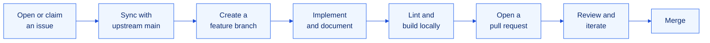

<div align="center">


<h1>Contributing Guide</h1>

<p><b>Thank you for helping build safer cities. This guide explains how to contribute effectively and consistently.</b></p>

<p>
  
  
  
</p>

<p>
  <a href="../README.md"><b>README</b></a>
  &nbsp;&nbsp;|&nbsp;&nbsp;
  <a href="BRAIN.md"><b>Project Brain</b></a>
  &nbsp;&nbsp;|&nbsp;&nbsp;
  <a href="../LICENSE"><b>License</b></a>
</p>

</div>


## Contents

1. [Code of Conduct](#1-code-of-conduct)
2. [Ways to Contribute](#2-ways-to-contribute)
3. [Development Setup](#3-development-setup)
4. [Contribution Workflow](#4-contribution-workflow)
5. [Branch Naming](#5-branch-naming)
6. [Commit Messages](#6-commit-messages)
7. [Coding Standards](#7-coding-standards)
8. [Working with Data and AI](#8-working-with-data-and-ai)
9. [Pull Request Checklist](#9-pull-request-checklist)
10. [Review Process](#10-review-process)
11. [Reporting Issues](#11-reporting-issues)
12. [Security](#12-security)


## 1. Code of Conduct

All contributors are expected to be respectful, constructive and inclusive. Critique ideas, not people. Harassment or discriminatory behaviour of any kind is not tolerated, and maintainers may remove contributions or contributors that do not meet this standard.

## 2. Ways to Contribute

| Area | Examples |
| :-- | :-- |
| Features | New scenarios such as Urban Flooding or Earthquake, road routing, report export |
| Bug fixes | Map rendering issues, API edge cases, validation gaps |
| Data | Better building naming, broader coverage, additional facility types |
| AI safety | Stronger prompts, tighter schemas, improved fallback guidance |
| Documentation | README, [Project Brain](BRAIN.md), inline comments, examples |
| Testing | Unit tests for geometry helpers and API validation |

Items listed under [Known Limitations](BRAIN.md#11-known-limitations) in the Project Brain are good starting points.

## 3. Development Setup

### 3.1 Prerequisites

| Tool | Version |
| :-- | :-- |
| Node.js | 20 or later |
| pnpm | The version pinned in `package.json` (`packageManager` field) |
| Git | 2.30 or later |

### 3.2 Local installation

```bash
# Fork the repository on GitHub, then clone your fork
git clone https://github.com/<your-username>/Chandigarh-SafeSim.git
cd Chandigarh-SafeSim

# Track the main repository
git remote add upstream https://github.com/holyarsenic/Chandigarh-SafeSim.git

# Install dependencies and configure the environment
pnpm install
cp .env.example .env.local

# Start the development server
pnpm dev
```

AI keys are optional. Without them the application uses its built-in guidance, which is sufficient for most frontend and map work.

### 3.3 Framework note

This project runs on **Next.js 16**, which includes breaking changes compared with earlier versions. Before writing framework-level code, read the relevant guide in `node_modules/next/dist/docs/` and follow any deprecation notices. See `AGENTS.md` for details.

## 4. Contribution Workflow



1. **Discuss first.** For anything larger than a small fix, open an issue describing the problem and the proposed approach before writing code.
2. **Sync.** `git fetch upstream && git checkout main && git merge upstream/main`
3. **Branch.** Create a branch from `main` using the naming rules below.
4. **Implement.** Keep the change focused on one concern. Update [BRAIN.md](BRAIN.md) when you change architecture, API contracts or algorithms.
5. **Verify.** Run `pnpm lint` and `pnpm build` and test the affected flow in the browser.
6. **Open a pull request** against `main` and complete the checklist in section 9.

## 5. Branch Naming

Use the format `<type>/<short-description>` in lowercase with hyphens.

| Prefix | Use for | Example |
| :-- | :-- | :-- |
| `feat/` | New functionality | `feat/flood-scenario` |
| `fix/` | Bug fixes | `fix/emergency-services` |
| `docs/` | Documentation only | `docs/api-contracts` |
| `refactor/` | Internal restructuring without behaviour change | `refactor/geometry-helpers` |
| `perf/` | Performance improvements | `perf/building-cache` |
| `test/` | Tests only | `test/intersection` |
| `chore/` | Tooling, dependencies, configuration | `chore/upgrade-maplibre` |

## 6. Commit Messages

This project follows [Conventional Commits](https://www.conventionalcommits.org/).

```text
<type>(<optional scope>): <imperative summary, 72 characters or fewer>

<optional body explaining what changed and why>

<optional footer, for example: Closes #12>
```

| Type | Meaning |
| :-- | :-- |
| `feat` | A new feature |
| `fix` | A bug fix |
| `docs` | Documentation changes |
| `style` | Formatting with no logic change |
| `refactor` | Code change that neither fixes a bug nor adds a feature |
| `perf` | Performance improvement |
| `test` | Adding or updating tests |
| `chore` | Build process, tooling or dependency changes |

**Examples**

```text
feat(map): highlight roads inside the impact zone
fix(api): reject radius values outside the allowed set
docs(brain): document the emergency-guidance response schema
```

## 7. Coding Standards

### 7.1 General

- Write **TypeScript** with strict typing. Avoid `any`; prefer `unknown` with narrowing.
- Keep functions small and named for what they do.
- Match the style of the surrounding code: naming, formatting and comment density.
- Remove unused code, debug logs and commented-out blocks before submitting.

### 7.2 Frontend

- Use **Tailwind CSS** utility classes for styling and keep the existing visual language.
- Use **Lucide** for icons. Do not use emoji in the interface or documentation.
- Cancel stale network requests with `AbortController` in effects.
- Provide loading, empty and error states for every asynchronous view.
- Keep the interface accessible: labelled controls, keyboard support and sufficient contrast.

### 7.3 API routes

- Validate every request body and query parameter, using **Zod** for structured input.
- Return a consistent shape: `{ success: true, ... }` or `{ success: false, error }` with an appropriate HTTP status.
- Apply a timeout to every outbound `fetch`.
- Never expose stack traces, API keys or raw upstream errors to the client.

### 7.4 File organisation

| Location | Contents |
| :-- | :-- |
| `app/` | Pages, layouts and route handlers |
| `app/api/<name>/route.ts` | One route handler per endpoint |
| `components/` | Reusable React components in PascalCase files |
| `Doc/` | Project documentation and artwork |
| `public/` | Static assets |

## 8. Working with Data and AI

Because SafeSim produces safety-related information, changes in this area receive extra scrutiny.

**OpenStreetMap and Overpass**

- Respect public Overpass usage limits. Cache results and avoid query patterns that fetch more data than needed.
- Keep the mirror failover and rate-limit handling intact.
- Preserve OpenStreetMap attribution wherever map data is displayed.

**AI prompts and outputs**

- Prompts must instruct models to use only supplied data and never invent facilities, distances, routes, availability or contact details.
- Every model response must be validated with a Zod schema before use.
- Every AI path must have a deterministic fallback.
- Do not weaken the safety rules in [BRAIN.md, section 9](BRAIN.md#9-safety-principles). A pull request that does so will not be merged.
- When changing a prompt, include before and after output samples in the pull request description.

## 9. Pull Request Checklist

Copy this checklist into your pull request description.

```markdown
### Summary
Describe what this pull request changes and why.

### Related issue
Closes #

### Type of change
- [ ] Feature
- [ ] Bug fix
- [ ] Documentation
- [ ] Refactor or performance
- [ ] Other

### Checklist
- [ ] The branch is up to date with `main`
- [ ] `pnpm lint` passes with no new warnings
- [ ] `pnpm build` completes successfully
- [ ] The affected flow was tested manually in the browser
- [ ] Inputs are validated and errors are handled
- [ ] AI output, if any, is schema-validated and has a fallback
- [ ] No secrets, keys or `.env` files are included
- [ ] `Doc/BRAIN.md` is updated if architecture, contracts or algorithms changed
- [ ] Screenshots are attached for visual changes
```

## 10. Review Process

| Stage | Expectation |
| :-- | :-- |
| Automated checks | Lint and build must pass |
| Code review | At least one maintainer approval is required before merge |
| Feedback | Respond to every review comment, either with a change or an explanation |
| Updates | Push follow-up commits to the same branch; do not open a new pull request |
| Merge | Maintainers merge once the pull request is approved and up to date |

Reviews focus on correctness, safety of user-facing guidance, clarity, performance and consistency with the existing architecture.

## 11. Reporting Issues

Before opening an issue, search existing issues to avoid duplicates.

**Bug reports** should include:

| Field | Description |
| :-- | :-- |
| Summary | One sentence describing the problem |
| Steps to reproduce | Numbered, minimal steps |
| Expected behaviour | What should happen |
| Actual behaviour | What happens instead, with error messages |
| Environment | Browser, operating system, Node.js version |
| Evidence | Screenshots or console and terminal output |

**Feature requests** should describe the problem being solved, the proposed solution, alternatives considered, and any safety implications.

## 12. Security

Do not report security vulnerabilities in public issues. Contact the maintainers privately through GitHub and include a description, reproduction steps and the potential impact. Never commit API keys; if a key is exposed, rotate it immediately and notify the maintainers.


<div align="center">
  <sub>By contributing, you agree that your contributions are licensed under the <a href="../LICENSE">MIT License</a>.</sub>
</div>
