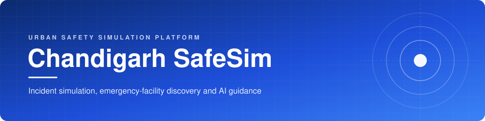
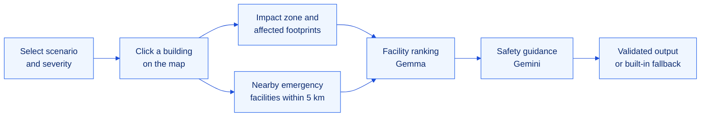
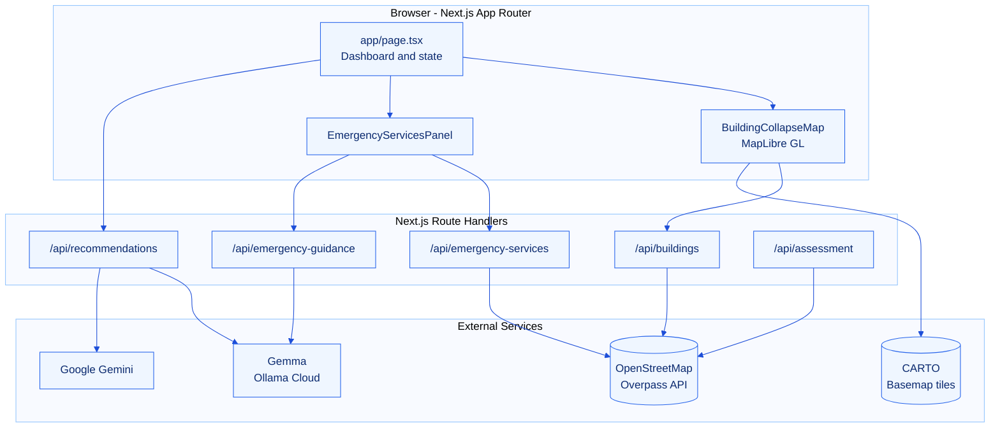

<div align="center">



<br/>

<p>
  <a href="#overview"></a>
  <a href="LICENSE"></a>
  <a href="Doc/CONTRIBUTING.md"></a>
</p>

<p>
  
  
  
  
  
  
  
  
</p>

<h3>Simulate an urban incident on real building footprints, find the emergency services around it,<br/>and receive grounded, safety-first guidance in seconds.</h3>

<p>
  <a href="#getting-started"><b>Getting Started</b></a>
  &nbsp;&nbsp;|&nbsp;&nbsp;
  <a href="#architecture"><b>Architecture</b></a>
  &nbsp;&nbsp;|&nbsp;&nbsp;
  <a href="#api-reference"><b>API Reference</b></a>
  &nbsp;&nbsp;|&nbsp;&nbsp;
  <a href="Doc/BRAIN.md"><b>Project Brain</b></a>
  &nbsp;&nbsp;|&nbsp;&nbsp;
  <a href="Doc/CONTRIBUTING.md"><b>Contributing</b></a>
</p>

</div>


## Table of Contents

1. [Overview](#overview)
2. [The Problem](#the-problem)
3. [Key Capabilities](#key-capabilities)
4. [How It Works](#how-it-works)
5. [Architecture](#architecture)
6. [Technology Stack](#technology-stack)
7. [Getting Started](#getting-started)
8. [Configuration](#configuration)
9. [API Reference](#api-reference)
10. [Project Structure](#project-structure)
11. [Responsible Design](#responsible-design)
12. [Roadmap](#roadmap)
13. [Documentation](#documentation)
14. [License](#license)


## Overview

**Chandigarh SafeSim** is an interactive, map-first urban safety simulation platform for the city of Chandigarh, India. A user selects any mapped building, chooses an incident scenario and a severity level, and the platform:

- draws an impact zone and identifies every mapped building footprint that intersects it,
- discovers real hospitals, clinics, police stations, fire stations and pharmacies nearby, and
- produces scenario-aware safety precautions and next steps using a two-stage AI pipeline that is strictly grounded in the facility data the application supplies.

The platform is built for **civic preparedness, education and planning exercises**. It is explicitly not a structural-damage predictor and never presents simulated output as a verified emergency assessment.

## The Problem

During an urban emergency, three questions matter most and are rarely answered in one place:

| Question | Typical reality | SafeSim response |
| :-- | :-- | :-- |
| What is around the incident? | Static maps with no notion of an impact area | Live building footprints with a configurable impact radius |
| Where is help? | Separate searches across several apps | Emergency facilities ranked by straight-line distance within 5 km |
| What should people do now? | Generic advice, or AI output that invents details | Scenario-specific guidance validated against a strict schema, with a deterministic fallback |

## Key Capabilities

<table>
  <tr>
    <td width="50%" valign="top">
      <h4>Geospatial Impact Simulation</h4>
      Click any building on a MapLibre GL vector map. A circular impact zone is rendered and every footprint whose geometry intersects it, not only its centroid, is highlighted and listed with type, floors and distance.
    </td>
    <td width="50%" valign="top">
      <h4>Scenario and Severity Control</h4>
      Building Collapse and Major Fire are available today. Severity maps to an illustrative radius of 75 m (Low), 150 m (Medium) or 250 m (High). Urban Flooding and Earthquake are on the roadmap.
    </td>
  </tr>
  <tr>
    <td width="50%" valign="top">
      <h4>Emergency Facility Discovery</h4>
      Queries OpenStreetMap through the Overpass API for hospitals, clinics, doctors, police, fire stations and pharmacies, sorted by distance, with a one-click directions link for each facility.
    </td>
    <td width="50%" valign="top">
      <h4>Two-Stage AI Guidance</h4>
      Gemma (via Ollama Cloud) ranks the most relevant facilities for the scenario. Gemini then writes precautions and next steps using only those records. Every response is validated with Zod.
    </td>
  </tr>
  <tr>
    <td width="50%" valign="top">
      <h4>Resilient by Default</h4>
      Multiple Overpass mirrors with automatic failover, in-memory caching, request de-duplication and rate-limit cooldowns keep the experience stable under load.
    </td>
    <td width="50%" valign="top">
      <h4>Deterministic Fallback</h4>
      If no AI key is configured, or a model fails or returns invalid output, the platform serves curated built-in guidance. The interface always clearly shows which provider produced the result.
    </td>
  </tr>
</table>

## How It Works



1. **Select** a scenario (Building Collapse or Major Fire) and a severity level.
2. **Click** a building. The map draws the impact zone and lists every intersecting footprint.
3. **Discover** emergency facilities around the selected building.
4. **Receive** guidance: facility ranking, precautions and next steps, all grounded in supplied data.

## Architecture



A deeper explanation of every module, data contract and design decision is maintained in the **[Project Brain](Doc/BRAIN.md)**.

## Technology Stack

| Layer | Technology | Purpose |
| :-- | :-- | :-- |
| Framework | Next.js 16 (App Router, Turbopack) | Pages, route handlers, server runtime |
| UI | React 19, Tailwind CSS 4, Lucide icons, Sonner | Interface, styling, notifications |
| Mapping | MapLibre GL 6, CARTO Dark Matter basemap | Vector map rendering and layers |
| Geospatial | Turf.js, custom haversine and polygon intersection | Distance and impact-zone calculations |
| Open data | OpenStreetMap via Overpass API | Building footprints and emergency facilities |
| AI | Gemma via Ollama Cloud, Google Gemini via `@google/genai` | Facility ranking and safety guidance |
| Validation | Zod 4 | Request and AI-response schemas |
| Language | TypeScript 5 (strict) | End-to-end type safety |

## Getting Started

### Prerequisites

| Requirement | Version |
| :-- | :-- |
| Node.js | 20 or later |
| pnpm | 10 or later (the repository pins its version in `package.json`) |
| API keys | Optional. The platform runs fully without them using built-in guidance. |

### Installation

```bash
# 1. Clone the repository
git clone https://github.com/holyarsenic/Chandigarh-SafeSim.git
cd Chandigarh-SafeSim

# 2. Install dependencies
pnpm install

# 3. Configure environment variables
cp .env.example .env.local

# 4. Start the development server
pnpm dev
```

Open **http://localhost:3000** in your browser.

### Available Scripts

| Command | Description |
| :-- | :-- |
| `pnpm dev` | Start the development server with hot reload |
| `pnpm build` | Create an optimized production build |
| `pnpm start` | Serve the production build |
| `pnpm lint` | Run ESLint across the project |

## Configuration

All variables are optional. When an AI key is missing, the corresponding stage falls back to deterministic logic.

| Variable | Default | Used by | Description |
| :-- | :-- | :-- | :-- |
| `OLLAMA_API_KEY` | none | `/api/recommendations`, `/api/emergency-guidance` | Ollama Cloud key for Gemma facility ranking and guidance |
| `OLLAMA_MODEL` | `gemma4:cloud` | same as above | Gemma model identifier |
| `GEMINI_API_KEY` | none | `/api/recommendations` | Google Gemini key for safety precautions and next steps |
| `GEMINI_MODEL` | `gemini-3.8-flash` | same as above | Gemini model identifier |

> **Security note:** never commit `.env` or `.env.local`. Both are ignored by Git.

## API Reference

All endpoints return JSON with a top-level `success` flag.

| Method | Endpoint | Description |
| :-- | :-- | :-- |
| `GET` | `/api/buildings` | Building footprints for central Chandigarh as a GeoJSON FeatureCollection. Cached for 30 minutes. |
| `GET` | `/api/emergency-services?lat=&lon=&radius=` | Emergency facilities within `radius` metres (100 to 20000, default 5000), sorted by distance. Cached for 5 minutes. |
| `POST` | `/api/recommendations` | Two-stage AI pipeline: Gemma ranks facilities, Gemini writes precautions and next steps. |
| `POST` | `/api/emergency-guidance` | Gemma guidance focused on the nearest facilities, with a built-in fallback. |
| `POST` | `/api/assessment` | Buildings and roads within a 75, 150 or 250 m radius of a point. |

<details>
<summary><b>Example: <code>POST /api/recommendations</code></b></summary>

**Request**

```json
{
  "scenario": "major-fire",
  "buildingName": "Government Building",
  "buildingType": "government",
  "levels": 4,
  "radius": 150,
  "affectedCount": 23,
  "facilities": [
    {
      "id": "node-123",
      "name": "Fire Station Sector 17",
      "type": "fire station",
      "location": [76.7821, 30.7398],
      "straightLineMeters": 640,
      "directionsUrl": "https://www.google.com/maps/dir/?api=1&origin=30.7333,76.7794&destination=30.7398,76.7821&travelmode=driving"
    }
  ]
}
```

**Response**

```json
{
  "success": true,
  "data": {
    "summary": "...",
    "precautions": [{ "title": "...", "description": "..." }],
    "nextSteps": ["..."],
    "nearbyFacilities": [ ... ],
    "facilityAnalysis": "..."
  },
  "provider": "gemini",
  "facilityProvider": "gemma",
  "fallback": false
}
```

</details>

The complete request and response contracts for every endpoint are documented in [Doc/BRAIN.md](Doc/BRAIN.md#5-api-contracts).

## Project Structure

```text
Chandigarh-SafeSim/
├── app/
│   ├── api/
│   │   ├── assessment/route.ts           Buildings and roads around a point
│   │   ├── buildings/route.ts            City building footprints (cached)
│   │   ├── emergency-guidance/route.ts   Gemma guidance with fallback
│   │   ├── emergency-services/route.ts   Nearby emergency facilities
│   │   └── recommendations/route.ts      Gemma ranking and Gemini guidance
│   ├── globals.css
│   ├── layout.tsx                        Root layout, fonts, metadata
│   └── page.tsx                          Dashboard and application state
├── components/
│   ├── BuildingCollapseMap.tsx           MapLibre map and impact-zone engine
│   └── EmergencyServicesPanel.tsx        Facility list and guidance panel
├── Doc/
│   ├── assets/                           Documentation artwork
│   ├── BRAIN.md                          Architecture and knowledge base
│   └── CONTRIBUTING.md                   Contribution guidelines
├── public/                               Favicons and MapLibre workers
├── .env.example
├── LICENSE
└── package.json
```

## Responsible Design

SafeSim deals with safety information, so accuracy and honesty are treated as product requirements rather than afterthoughts.

- **No invented facts.** AI prompts forbid inventing facilities, distances, routes, opening hours or availability. Facility IDs returned by the model are matched back to real records, and unknown IDs are discarded.
- **Schema-validated output.** Every AI response is parsed and validated with Zod before it reaches the user.
- **Always-available fallback.** Curated guidance is returned whenever AI is unavailable or its output fails validation.
- **Clear limitations.** Distances are straight-line, not road distance or travel time. Radii are illustrative and do not predict structural damage or fire spread.
- **Real emergencies first.** Guidance consistently directs users in India to call **112**.

> **Disclaimer:** Chandigarh SafeSim is a simulation and education tool. It is not a substitute for official emergency services, structural engineering assessment or instructions from local authorities.

## Roadmap

| Phase | Item | Status |
| :-- | :-- | :-- |
| 1 | Building Collapse scenario | Available |
| 1 | Major Fire scenario | Available |
| 1 | Emergency facility discovery and AI guidance | Available |
| 2 | Urban Flooding scenario using elevation and drainage data | Planned |
| 2 | Earthquake scenario with building-age and height weighting | Planned |
| 2 | Road-network routing and blocked-road simulation | Planned |
| 3 | Persistent data layer and shareable simulation reports | Planned |
| 3 | Multilingual guidance (Hindi and Punjabi) | Planned |

## Documentation

| Document | Description |
| :-- | :-- |
| [Project Brain](Doc/BRAIN.md) | Architecture, data flow, algorithms, API contracts and design decisions |
| [Contributing Guide](Doc/CONTRIBUTING.md) | Workflow, coding standards, commit conventions and review process |
| [License](LICENSE) | MIT License |

## License

Distributed under the **MIT License**. See [LICENSE](LICENSE) for details.

Map data is provided by [OpenStreetMap](https://www.openstreetmap.org/copyright) contributors under the ODbL. Basemap tiles are provided by [CARTO](https://carto.com/attributions).


<div align="center">
  <sub>Built for safer cities, starting with Chandigarh.</sub>
</div>
