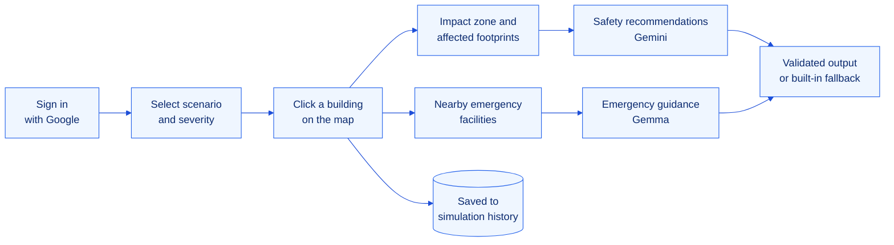
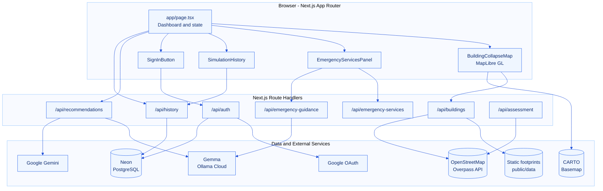

<div align="center">


<br/>

<p>
  <a href="#overview"></a>
  <a href="LICENSE"></a>
  <a href="doc/CONTRIBUTING.md"></a>
</p>

<p>
  
  
  
  
  
  
  
  
  
</p>

<h3>Simulate an urban incident on real Chandigarh building footprints, locate emergency services,<br/>receive grounded safety guidance and keep a personal history of every simulation.</h3>

<p>
  <a href="#getting-started"><b>Getting Started</b></a>
  &nbsp;&nbsp;|&nbsp;&nbsp;
  <a href="#architecture"><b>Architecture</b></a>
  &nbsp;&nbsp;|&nbsp;&nbsp;
  <a href="#api-reference"><b>API Reference</b></a>
  &nbsp;&nbsp;|&nbsp;&nbsp;
  <a href="doc/BRAIN.md"><b>Project Brain</b></a>
  &nbsp;&nbsp;|&nbsp;&nbsp;
  <a href="doc/CONTRIBUTING.md"><b>Contributing</b></a>
</p>

</div>


## Table of Contents

1. [Overview](#overview)
2. [The Problem](#the-problem)
3. [Key Capabilities](#key-capabilities)
4. [How It Works](#how-it-works)
5. [Architecture](#architecture)
6. [Technology Stack](#technology-stack)
7. [Getting Started](#getting-started)
8. [Configuration](#configuration)
9. [Database Setup](#database-setup)
10. [API Reference](#api-reference)
11. [Project Structure](#project-structure)
12. [Responsible Design](#responsible-design)
13. [Roadmap](#roadmap)
14. [Documentation](#documentation)
15. [License](#license)


## Overview

**Chandigarh SafeSim** is an interactive, map-first urban safety simulation platform for Chandigarh, India. A user signs in with Google, selects any mapped building, chooses an incident scenario and a severity level, and the platform:

- draws an impact zone and identifies every building footprint that intersects it,
- lists nearby hospitals, fire stations and police headquarters with straight-line distance and directions,
- produces scenario-aware safety guidance, including immediate actions, evacuation instructions and what to do if trapped, and
- saves the simulation to the user's personal history in a Neon PostgreSQL database.

The platform is built for **civic preparedness, education and planning exercises**. It is not a structural-damage predictor and never presents simulated output as a verified emergency assessment.

## The Problem

During an urban emergency, three questions matter most and are rarely answered in one place:

| Question | Typical reality | SafeSim response |
| :-- | :-- | :-- |
| What is around the incident? | Static maps with no notion of an impact area | Building footprints with a configurable impact radius |
| Where is help? | Separate searches across several apps | Key emergency facilities ranked by straight-line distance, with directions |
| What should people do now? | Generic advice, or AI output that invents details | Structured, scenario-specific guidance validated against a strict schema, with a deterministic fallback |

## Key Capabilities

<table>
  <tr>
    <td width="50%" valign="top">
      <h4>Geospatial Impact Simulation</h4>
      Click any building on a MapLibre GL map. A circular impact zone is drawn, and every footprint whose geometry intersects it (not only its centre point) is highlighted and listed with its type, floors and distance.
    </td>
    <td width="50%" valign="top">
      <h4>Scenario and Severity Control</h4>
      Building Collapse and Major Fire are available today. Severity sets an illustrative radius of 75 m (Low), 150 m (Medium) or 250 m (High). Urban Flooding and Earthquake are on the roadmap.
    </td>
  </tr>
  <tr>
    <td width="50%" valign="top">
      <h4>Emergency Facility Lookup</h4>
      A curated list of key Chandigarh facilities, including PGIMER, GMSH Sector 16, GMCH Sector 32, fire stations and police headquarters, sorted by straight-line distance, with a one-click directions link for each.
    </td>
    <td width="50%" valign="top">
      <h4>Structured Emergency Guidance</h4>
      Gemma (via Ollama Cloud) returns immediate actions, evacuation instructions, steps for people who are trapped, precautions and next steps. Gemini writes scenario-level precautions. Every AI response is validated with Zod.
    </td>
  </tr>
  <tr>
    <td width="50%" valign="top">
      <h4>Google Sign-In and Simulation History</h4>
      Users sign in with Google through Auth.js. Every building selection is saved to Neon PostgreSQL, and the History panel shows each user's 20 most recent simulations.
    </td>
    <td width="50%" valign="top">
      <h4>Fast and Resilient Data Loading</h4>
      Building footprints are served from a pre-fetched static file, then from memory and disk caches, then from five Overpass mirrors with failover. If every source fails, the app still loads instead of erroring.
    </td>
  </tr>
</table>

## How It Works



1. **Sign in** with a Google account.
2. **Select** a scenario (Building Collapse or Major Fire) and a severity level.
3. **Click** a building. The map draws the impact zone and lists every intersecting footprint.
4. **Review** nearby emergency facilities, structured emergency guidance and safety recommendations.
5. **Revisit** past simulations at any time from the History panel.

## Architecture



A deeper explanation of modules, data contracts and design decisions is maintained in the **[Project Brain](doc/BRAIN.md)**.

## Technology Stack

| Layer | Technology | Purpose |
| :-- | :-- | :-- |
| Framework | Next.js 16 (App Router, Turbopack) | Pages, route handlers, server runtime |
| UI | React 19, Tailwind CSS 4, Motion, Lucide icons, Sonner | Interface, animation, notifications |
| Mapping | MapLibre GL 6, CARTO Dark Matter basemap | Vector map rendering and layers |
| Geospatial | Turf.js, custom haversine and polygon intersection | Distance and impact-zone calculations |
| Authentication | Auth.js (NextAuth v5) with Google provider | Sign-in and JWT sessions |
| Database | Neon serverless PostgreSQL | User accounts and simulation history |
| Open data | OpenStreetMap via Overpass API | Building footprints |
| AI | Gemma via Ollama Cloud, Google Gemini via `@google/genai` | Emergency guidance and safety recommendations |
| Validation | Zod 4 | Request and AI-response schemas |
| Language | TypeScript 5 (strict) | End-to-end type safety |

## Getting Started

### Prerequisites

| Requirement | Notes |
| :-- | :-- |
| Node.js | 20 or later |
| pnpm | The version pinned in `package.json` |
| Neon database | Required for sign-in and history. Free tier is sufficient. |
| Google OAuth client | Required for sign-in |
| AI keys | Optional. The app falls back to built-in guidance without them. |

### Installation

```bash
# 1. Clone the repository
git clone https://github.com/holyarsenic/Chandigarh-SafeSim.git
cd Chandigarh-SafeSim

# 2. Install dependencies
pnpm install

# 3. Configure environment variables
cp .env.example .env.local

# 4. Start the development server
pnpm dev
```

Open **http://localhost:3000** in your browser.

### Refreshing Building Data (optional)

Building footprints for central Chandigarh are already included in `public/data/buildings.json`. To download a fresh copy from OpenStreetMap:

```bash
node scripts/prefetch-buildings.mjs
```

### Available Scripts

| Command | Description |
| :-- | :-- |
| `pnpm dev` | Start the development server with hot reload |
| `pnpm build` | Create an optimized production build |
| `pnpm start` | Serve the production build |
| `pnpm lint` | Run ESLint across the project |

## Configuration

Create `.env.local` in the project root with the following variables.

| Variable | Required | Description |
| :-- | :-- | :-- |
| `DATABASE_URL` | Yes, for sign-in and history | Neon PostgreSQL connection string |
| `AUTH_SECRET` | Yes, for sign-in | Random secret for Auth.js. Generate with `npx auth secret`. |
| `AUTH_GOOGLE_ID` | Yes, for sign-in | Google OAuth client ID |
| `AUTH_GOOGLE_SECRET` | Yes, for sign-in | Google OAuth client secret |
| `OLLAMA_API_KEY` | Optional | Ollama Cloud key for Gemma guidance and facility ranking |
| `OLLAMA_MODEL` | Optional | Defaults to `gemma4:cloud` |
| `GEMINI_API_KEY` | Optional | Google Gemini key for safety recommendations |
| `GEMINI_MODEL` | Optional | Defaults to `gemini-3.8-flash` |

When creating the Google OAuth client, add this authorised redirect URI:

```text
http://localhost:3000/api/auth/callback/google
```

> **Security note:** never commit `.env` or `.env.local`. Both are ignored by Git.

## Database Setup

Run the following SQL once in the Neon SQL editor to create the tables used by sign-in and simulation history.

```sql
CREATE TABLE IF NOT EXISTS users (
  id         SERIAL PRIMARY KEY,
  name       TEXT,
  email      TEXT UNIQUE NOT NULL,
  image      TEXT,
  created_at TIMESTAMPTZ DEFAULT CURRENT_TIMESTAMP
);

CREATE TABLE IF NOT EXISTS simulations (
  id              SERIAL PRIMARY KEY,
  user_id         INTEGER NOT NULL REFERENCES users(id) ON DELETE CASCADE,
  latitude        DOUBLE PRECISION NOT NULL,
  longitude       DOUBLE PRECISION NOT NULL,
  radius          INTEGER NOT NULL,
  hazard_index    DOUBLE PRECISION DEFAULT 0,
  created_at      TIMESTAMPTZ DEFAULT CURRENT_TIMESTAMP,
  geojson_payload JSONB
);
```

## API Reference

All endpoints return JSON with a top-level `success` flag.

| Method | Endpoint | Auth | Description |
| :-- | :-- | :-- | :-- |
| `GET` | `/api/buildings` | No | Building footprints for central Chandigarh as a GeoJSON FeatureCollection |
| `GET` | `/api/emergency-services?lat=&lon=&radius=` | No | Curated emergency facilities within `radius` metres (default 5000), sorted by distance |
| `POST` | `/api/emergency-guidance` | No | Structured guidance: immediate actions, evacuation, if trapped, precautions, next steps |
| `POST` | `/api/recommendations` | No | Safety summary, precautions and next steps for the selected scenario |
| `GET` | `/api/history` | Yes | The signed-in user's 20 most recent simulations |
| `POST` | `/api/history` | Yes | Save a simulation for the signed-in user |
| `POST` | `/api/assessment` | No | Buildings and roads within a 75, 150 or 250 m radius of a point |
| `GET` `POST` | `/api/auth/*` | No | Auth.js sign-in, sign-out and session endpoints |

<details>
<summary><b>Example: <code>POST /api/emergency-guidance</code></b></summary>

**Request**

```json
{
  "buildingName": "Sector 17 Central Plaza",
  "scenario": "major-fire",
  "location": { "latitude": 30.7395, "longitude": 76.7795 },
  "facilities": [
    {
      "id": "fire-1",
      "name": "Sector 17 Central Fire Station",
      "type": "fire_station",
      "latitude": 30.741,
      "longitude": 76.782,
      "straightLineMeters": 290,
      "directionsUrl": "https://www.google.com/maps/dir/?api=1&origin=30.7395,76.7795&destination=30.741,76.782&travelmode=driving"
    }
  ]
}
```

**Response**

```json
{
  "success": true,
  "provider": "gemma",
  "scenario": "major-fire",
  "emergencyNumber": "112",
  "guidance": {
    "immediateActions": ["..."],
    "evacuationInstructions": ["..."],
    "ifTrapped": ["..."],
    "precautions": ["..."],
    "nextSteps": ["..."]
  },
  "nearestFacility": {
    "name": "Sector 17 Central Fire Station",
    "distanceLabel": "290 m",
    "warning": "Nearest by straight-line distance only. Route safety, opening status, and service availability have not been verified."
  },
  "disclaimer": "This is planning support, not a live hazard assessment. Follow emergency services and local authorities."
}
```

</details>

## Project Structure

```text
Chandigarh-SafeSim/
├── app/
│   ├── api/
│   │   ├── assessment/route.ts            Buildings and roads around a point
│   │   ├── auth/[...nextauth]/route.ts    Auth.js handlers
│   │   ├── buildings/route.ts             Footprints with layered caching
│   │   ├── emergency-guidance/route.ts    Structured Gemma guidance with fallback
│   │   ├── emergency-services/route.ts    Curated emergency facilities
│   │   ├── history/route.ts               Save and list user simulations
│   │   └── recommendations/route.ts       Gemma ranking and Gemini guidance
│   ├── globals.css
│   ├── layout.tsx                         Root layout, session provider, metadata
│   └── page.tsx                           Dashboard and application state
├── components/
│   ├── BuildingCollapseMap.tsx            MapLibre map and impact-zone engine
│   ├── EmergencyServicesPanel.tsx         Facilities and emergency guidance
│   ├── Scenarios.tsx                      Animated scenario selector
│   ├── History/SimulationHistory.tsx      Simulation history panel
│   └── ui/
│       ├── SignInButton.tsx               Google sign-in and profile
│       └── button.tsx                     Shared button
├── lib/
│   ├── auth.ts                            Auth.js configuration
│   ├── database.ts                        Neon connection helper
│   └── data/chandigarh_buildings.json     Curated landmark footprints
├── scripts/
│   └── prefetch-buildings.mjs             Downloads footprints to public/data
├── public/
│   ├── data/buildings.json                Pre-fetched building footprints
│   ├── favicon/
│   └── maplibre/                          MapLibre web workers
├── doc/
│   ├── assets/                            Documentation artwork
│   ├── BRAIN.md                           Architecture and knowledge base
│   └── CONTRIBUTING.md                    Contribution guidelines
├── .env.example
├── LICENSE
└── package.json
```

## Responsible Design

SafeSim deals with safety information, so accuracy and honesty are treated as product requirements.

- **No invented facts.** AI prompts forbid inventing facilities, safe buildings, exits, routes, distances or availability. Facility IDs returned by a model are matched back to real records, and unknown IDs are discarded.
- **Nearest is not safest.** The nearest facility is labelled as straight-line nearest only, with an explicit warning that route safety and availability are not verified.
- **Schema-validated output.** Every AI response is validated with Zod before it reaches the user.
- **Always-available fallback.** Curated guidance is returned whenever AI is unavailable or its output fails validation.
- **Private history.** Simulation history is tied to the signed-in Google account and is only returned to that user.
- **Real emergencies first.** Guidance consistently directs users in India to call **112**.

> **Disclaimer:** Chandigarh SafeSim is a simulation and education tool. It is not a substitute for official emergency services, structural engineering assessment or instructions from local authorities.

## Roadmap

| Phase | Item | Status |
| :-- | :-- | :-- |
| 1 | Building Collapse and Major Fire scenarios | Available |
| 1 | Emergency facility lookup and structured AI guidance | Available |
| 1 | Google sign-in and personal simulation history | Available |
| 2 | Urban Flooding scenario using elevation and drainage data | Planned |
| 2 | Earthquake scenario with building-age and height weighting | Planned |
| 2 | Live facility data and road-network routing | Planned |
| 3 | Shareable simulation reports | Planned |
| 3 | Multilingual guidance (Hindi and Punjabi) | Planned |

## Documentation

| Document | Description |
| :-- | :-- |
| [Project Brain](doc/BRAIN.md) | Architecture, data flow, algorithms, API contracts and design decisions |
| [Contributing Guide](doc/CONTRIBUTING.md) | Workflow, coding standards, commit conventions and review process |
| [License](LICENSE) | MIT License |

## License

Distributed under the **MIT License**. See [LICENSE](LICENSE) for details.

Map data is provided by [OpenStreetMap](https://www.openstreetmap.org/copyright) contributors under the ODbL. Basemap tiles are provided by [CARTO](https://carto.com/attributions).


<div align="center">
  <sub>Built for safer cities, starting with Chandigarh.</sub>
</div>
